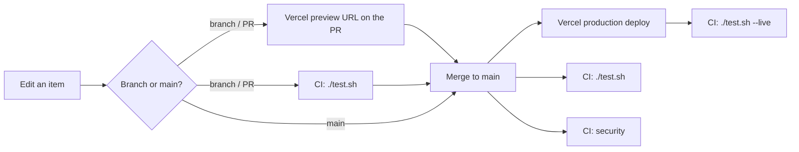

# Patriot Package

A gift package for America's 250th (1776–2026): founding documents, history, coins and keepsakes.

**Live:** https://patriot-package.vercel.app

## The list

Each item is one Markdown file in [`src/content/items/`](src/content/items/). The page groups items by
category, and anything still undecided gets an "Idea" badge.

| Field | Required | Values |
|---|---|---|
| `title` | yes | text |
| `category` | yes | `document`, `book`, `coin`, `keepsake` (headings in `src/consts.ts`) |
| `status` | yes | `confirmed` (in the package) or `speculative` (an idea) |
| `order` | yes | integer, sort order on the page |
| `image`, `imageAlt` | no | a photo in `src/assets/items/` (public domain or CC0 only, listed in [CREDITS.md](CREDITS.md)) and its alt text, which is required with an image |
| `byline` | no | one line under the title, e.g. author, pages and format |
| `imageUrl` | no | instead of `image`: the seller's own photo, loaded from their site, only on hosts in `HOTLINK_HOSTS` (`src/consts.ts`) and credited in [CREDITS.md](CREDITS.md) |
| `link` | no | `url` and `label`: where to get it (a shop) or read about it |
| `about` | no | `url` and `label`: a second link, to background from an official source |
| `source`, `priceUsd` | no | where it comes from, a price in dollars |

Photos are cropped to 4:3 WebP at 800×600 before they are committed. Astro serves 400px and 800px
versions. The body below the frontmatter is the item's description. A file that breaks the schema fails the
build. Prefix a file name with `_` to keep it as a draft.

## Commands

```bash
./init.sh                 # toolchain check, npm ci (only if stale), test browser, Astro types; --clean, --test
./run.sh                  # dev server on http://localhost:4321/
./run.sh build            # production build into dist/
./run.sh lint             # shellcheck + astro check
./test.sh                 # every check, every link included: ~130 checks in ~30s
./test.sh --offline       # everything except outbound links (what CI runs per push)
./test.sh --quick         # static checks and outbound links, no build or browser
./test.sh --live https://patriot-package.vercel.app   # check the deployed site
```

### What `./test.sh` checks

| Section | Checks |
|---|---|
| Environment | Node ≥ 22.12, and the same major as `.nvmrc` (warns otherwise) |
| Dependencies | `package.json`, `package-lock.json` and `node_modules` agree |
| Scripts | executable, `#!/usr/bin/env bash`, parse under macOS bash 3.2, `--help`, shellcheck `-S warning` |
| Config | exact pins, `.nvmrc` matches `engines`, CC0 LICENSE naming the holder, `vercel.json`, Actions pinned by SHA, security workflow |
| Content | every item has an https link; every image is used, WebP, the right size, ≤ 120 KB and in `CREDITS.md` as public domain or CC0 |
| Repository hygiene | no `.env`, build output, media or raw JPEG/PNG in git; no file over 1 MB |
| Type-check | `astro check` |
| Build and output | `astro build`, every item rendered, 400w/800w `srcset`, lazy photos, width and height on every `img` |
| Links in the page | every anchor has a target, local paths exist, the 404 page links home, each card links to its item file's URL |
| Meta, contrast, weight | canonical, Open Graph, `theme-color`, build commit; WCAG AA for every colour pair; 100 KB HTML+CSS+JS budget |
| Browser | Playwright at 1280, 375 and 320px: items, console errors, horizontal scroll, 404, tap targets, jump nav, badges, photos, links |
| Outbound links (off with `--offline`) | every link on the built page and every `CREDITS.md` source answers, with one retry. Cloudflare-challenged hosts are skipped with a reason. CI checks them weekly (`links.yml`) |

`scripts/checks.mjs` holds the Dependencies, Config, Content, page-link and outbound-link checks.

## How a change ships



Details, rollback and configuration: [DEPLOYMENT.md](DEPLOYMENT.md). Ideas for letting people build their
own package: [docs/package-builder.md](docs/package-builder.md); for buying and sending one through the
shops that sell each item: [docs/shoppable.md](docs/shoppable.md). Why it is built this way:
[docs/DECISIONS.md](docs/DECISIONS.md).

## License

[CC0 1.0](LICENSE): public domain, code included.
