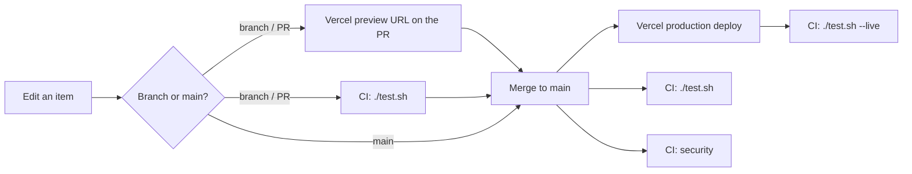

# Patriot Package

A gift package for America's 250th (1776–2026): founding documents, history, coins and keepsakes.

**Live:** https://patriot-package.vercel.app

## The list

Each item is one Markdown file in [`src/content/items/`](src/content/items/). The page groups items by
category, and anything still undecided gets an "Idea" badge.

| Field | Required | Values |
|---|---|---|
| `title` | yes | text |
| `category` | yes | `document`, `book`, `coin`, `keepsake` (headings in `src/consts.ts`) |
| `status` | yes | `confirmed` (in the package) or `speculative` (an idea) |
| `order` | yes | integer, sort order on the page |
| `image`, `imageAlt` | no | a photo in `src/assets/items/` (public domain or CC0 only, listed in [CREDITS.md](CREDITS.md)) and its alt text, which is required with an image |
| `link` | no | `url` and `label`: where to read about it or get it, from an official source where one exists |
| `source`, `priceUsd` | no | where it comes from, a price in dollars |

Photos are cropped to 4:3 WebP at 800×600 before they are committed. Astro serves 400px and 800px
versions. The body below the frontmatter is the item's description. A file that breaks the schema fails the
build. Prefix a file name with `_` to keep it as a draft.

## Commands

```bash
./init.sh                 # check Node ≥22.12, npm ci
./run.sh                  # dev server on http://localhost:4321/
./run.sh build            # production build into dist/
./test.sh                 # build + every check + browser tests (what CI runs)
./test.sh --live https://patriot-package.vercel.app   # check the deployed site
```

## How a change ships



Details, rollback and configuration: [DEPLOYMENT.md](DEPLOYMENT.md). Why it is built this way:
[docs/DECISIONS.md](docs/DECISIONS.md).

## License

[CC0 1.0](LICENSE): public domain, code included.
