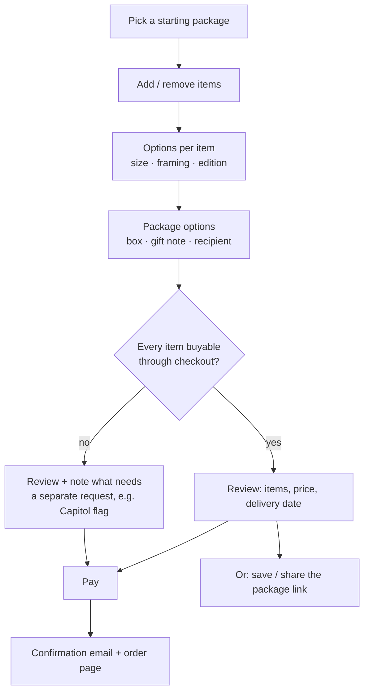

# Package builder — ideas

Status: **ideation, nothing built.** This is a working document for deciding *whether* and *how* to
let people put together their own Patriot Package. Decisions that come out of it go in
`docs/DECISIONS.md`; open questions are listed at the end and tracked in `TODO.md`.

## The idea in one paragraph

Today the site is one fixed list. A builder would let a visitor start from that list, add or remove
items, pick options (size, framing, a gift note), see a running price, and then either **order** it
or **share** it. Typical buyers: someone giving a 250th-anniversary gift to a parent, a new citizen,
a retiring veteran, a teacher, or a company sending one to every employee.

## Who it is for, and what they want

| Buyer | Wants | Implication |
|---|---|---|
| Gift-giver, one package | Something meaningful without research; a deadline (birthday, July 4) | Good defaults, delivery date shown up front |
| New citizen / their family | Founding documents, a naturalization-themed item | A "New citizen" starting package |
| School or teacher | Documents and books for a classroom; budget limits | A price cap filter; bulk quantity |
| Company / organisation | Many identical packages, maybe a logo card | Quantity pricing, a quote instead of checkout |

## How it could work for the visitor

1. **Start** from a preset: *Founding Documents*, *New Citizen*, *Coin Collector*, *Classroom*, or
   *Blank*. Presets are just lists of item ids, so they are cheap to add.
2. **Pick items** from the same cards the site shows now, each with an *Add* toggle. Items that are
   still ideas (status `speculative`) would not be orderable until decided.
3. **Options per item**, only where real choices exist: a print size or frame for documents,
   proof vs. uncirculated for a coin, hardcover vs. paperback for a book.
4. **Package options:** presentation box, a printed gift note (with a character limit), ship to the
   buyer or straight to the recipient, a target delivery date.
5. **Running total** that updates live, with shipping and tax shown before payment, never after.
6. **Share** a package as a link (the selection encoded in the URL, nothing stored) so someone can
   send it to a spouse or a committee before buying.

## Constraints that shape the design

These come from the items themselves and are why "add to cart" is not the whole answer.

- **Not everything can be resold.** A flag flown over the Capitol is requested through a
  member of Congress's office, not bought from a shop (the Capitol Flag Program link on the site).
  The U.S. Mint does not sell bullion American Eagles to the public; dealers do. These items
  either need a "we'll arrange it" service with a lead time, or the builder links out and says so.
- **Precious metals.** A silver coin's price moves with the silver price, so a fixed catalog
  price goes stale. Options: price it at order time from a dealer, or offer only the Mint's
  collector (proof) versions, which have a fixed list price.
- **Reproductions and the Great Seal.** Facsimiles of the founding documents are fine (they are
  public domain); anything bearing the Great Seal is restricted (18 U.S.C. § 713) and should be
  left out, as it already is on the site.
- **Names.** "America250" belongs to the official commission; a product called "America250 Package"
  would invite trouble. Keep the "Patriot Package" name and only *link* to official sites.
- **Hosting terms.** Vercel's Hobby plan is non-commercial. Taking orders means moving the project
  to Pro first (`DEPLOYMENT.md` § Plan limits).
- **Personal data.** Orders carry names, addresses, emails and gift notes — the recipient's data
  too, who never agreed to anything. Collect the minimum, keep it only as long as needed for
  fulfilment and returns, and keep it out of this public repo entirely
  (`dotfiles/docs/policy/privacy-by-design.md`).
- **Sales tax and shipping** depend on the destination state and on weight; coins and framed items
  need insured shipping.

## Buying and sending

The items are sold by other shops, not stocked here, so the stock-holding options first sketched
for this document (own checkout, own store) are dropped. How a built package gets bought and sent,
and the goal behind it (as frictionless as possible to send one to a friend or relative), is in
[shoppable.md](shoppable.md).

## What the builder page would add to this repo

- `src/content/presets/*.md`: one file per starting package (a title, a short pitch, a list of
  item ids). A schema rejects unknown ids, the same way items are validated today.
- `src/pages/build.astro`: the builder page. Item cards with an *Add* toggle, a summary panel
  (sticky at the bottom on phones), and a share link. The selection lives in the URL
  (`/build?items=constitution,silver-coin&note=…`), so there is no database and nothing to store.
- Item frontmatter gains what a builder needs: `priceUsd` (already in the schema), `options`
  (e.g. sizes), and an `orderable` flag that is false for items that cannot be checked out.
- Tests: building a package from each preset, the share link restoring the same selection, the
  total matching the sum of item prices, and the builder at 320px.

## Open questions for Pieter

Buying, fulfilment and fees are asked in [shoppable.md](shoppable.md#open-questions-for-pieter).

1. **Which presets** matter most — new citizens, classrooms, collectors, companies?
2. **Price ceiling.** Is there a target price for a standard package?
3. **The Capitol flag:** offer it as an arranged extra with a lead time, or link out only?
4. **Branding of the box and note** — is a custom box part of the idea?

