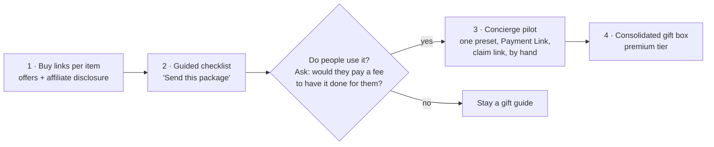

# Making the package shoppable

Status: **ideation, nothing built.** Decisions that come out of this go in `docs/DECISIONS.md`;
open questions are at the end and tracked in `TODO.md`. The builder screen itself (presets, picking
items, the share link) is in [package-builder.md](package-builder.md); this document is about the
buying and sending.

## The goal

> **Make it as frictionless as possible to send a Patriot Package to a friend or relative.**

Frictionless means, from the sender's side:

1. **One decision.** Pick a package (or adjust one) — no researching where to buy each item.
2. **One payment.** Pay once, not once per shop.
3. **No address needed.** The sender knows the recipient's name and email or phone, not
   necessarily their street address.
4. **It arrives as a gift.** A note, no prices or invoices in the box, ideally arriving together
   and around the date that matters (a birthday, July 4).
5. **One place to see status.** "Ordered → shipped → delivered", not five tracking emails.

Every idea below is judged by how many of these five it delivers, and at what cost to run.

## The constraint: we sell nothing ourselves

The items are offered by other shops. The site does not hold stock.

| Item (examples) | Who sells it (examples, to verify per item) | What that means |
|---|---|---|
| 1 oz American Silver Eagle | Bullion dealers such as APMEX and its competitors; the U.S. Mint sells only the collector (proof / uncirculated) versions direct | Price moves with silver every day; several competing offers per coin |
| U.S. Mint proof set | U.S. Mint, then dealers | Fixed list price at the Mint; can sell out |
| Founding-document facsimiles, Federalist Papers, history book | Bookshops, museum shops, general marketplaces | Many offers, stable prices |
| Liberty Bell replica, framed newspaper reproduction | Gift and museum shops, marketplaces | Quality varies; needs curation |
| Flag flown over the Capitol | Only through a member of Congress's office | Cannot be bought in a shop at all; weeks of lead time |

So "shoppable" means **coordinating purchases at several shops** on the sender's behalf, or
handing the sender a route through them. Each shop has its own checkout, shipping, packing slip
and (for bullion) price.

## Five ways to do it

| | Approach | What the sender does | Goal points met | What it costs to run |
|---|---|---|---|---|
| **1** | **Buy links per item** (today, made better) | Clicks "Buy at APMEX" etc. per item, checks out N times, types the recipient's address N times, ticks "this is a gift" where the shop offers it | 1 | Nothing; optional affiliate income |
| **2** | **Guided checklist** | Same N checkouts, but the site walks through them in order, remembers what is done, and pre-writes the gift note to paste | 1, partly 5 | Small: a client-side page |
| **3** | **Concierge, drop-shipped** | Pays once on our site; we place the N orders at the shops, shipping straight to the recipient | 1, 2, 5; 3 with a claim link | We front the money, place orders by hand, handle problems; a service fee covers it |
| **4** | **Concierge, consolidated** | Same, but the shops ship to us; we repack everything in one gift box with the note | All five | Most work and slowest: a packing space, boxes, re-shipping |
| **5** | **Partner gifting platform** | We list the package on a gifting service (e.g. Goody, which lets the recipient enter their own address) or a store app that supports address-free gifting | 2, 3, often 4–5 | Their fees and catalog rules; the items must be on their platform or in a store we run |

### 1. Buy links per item

- Each item gets **one to three offers** instead of a single link: shop name, link, price if stable,
  and the date it was last checked. Bullion shows "price set at checkout" instead of a number.
- **Affiliate links** can earn a commission. APMEX, for example, runs an affiliate programme through
  affiliate networks (terms differ between listings — confirm with APMEX). The site would then need a
  clear disclosure on every page with such links, which the FTC requires.
- Friction left: N checkouts, the address typed N times, N boxes with N packing slips, no single
  note.

### 2. Guided checklist

- A "Send this package" page: the sender enters the recipient's name and a note once; the page lists
  each shop in turn with the address and note ready to copy, and ticks items off as they come back.
- Progress lives in the browser (no account, no stored personal data on our side).
- Removes the research and the bookkeeping, not the N checkouts.

### 3. Concierge, drop-shipped

- One checkout on our site (a hosted payment page such as a Stripe Payment Link, so we never
  handle card numbers). The price is items + shipping + a service fee; for bullion, the quote holds
  for a short window and is re-priced if it expires.
- We place the orders at each shop with the recipient's address and "gift" options where offered.
- **Claim link:** instead of asking the sender for an address, we text or email the recipient a link
  where they enter it themselves (the pattern gifting services such as Goody use). The sender only
  needs a phone number or email.
- One order page shows each item's status, updated by hand at first.
- Friction left for the sender: none of the five goal points is missed except "arrives together"
  (several boxes from several shops). Cost moves to us: our time per order, refunds when a shop
  cancels, and sales tax on what we charge.

### 4. Concierge, consolidated

- Shops ship to us; we check every item, add the printed note, pack one box and ship it.
- The best gift: one box, no foreign packing slips, one tracking number, a chosen arrival date.
- The slowest and most work, and it needs a place to receive and pack. Best saved for proven demand
  or for the "premium" tier.

### 5. Partner gifting platform

- Gifting platforms already solve the claim link, one payment and recipient-entered addresses.
  Goody, for example, delivers to US addresses only and recipients can swap a gift unless swapping is
  turned off.
- They sell from their own catalog of brands, so our curated multi-shop package probably does not
  fit as-is. Worth one conversation before building approaches 3–4 ourselves.

## Suggested path

1. **Now:** approach 1 — every item gets real offers with prices and a "checked on" date. Cheap,
   reversible, and useful on its own.
2. **Next:** approach 2 — the guided "Send this package" page. Still no backend.
3. **Pilot:** approach 3 for **one** preset package, run by hand: a Stripe Payment Link, a form for
   the claim link, orders placed manually. A handful of real orders tells us whether the fee, the
   lead time and the work are acceptable before writing any order system.
4. **Later:** approach 4 as a premium option if the pilot works.

## What changes in the repo, step by step

- **Step 1:** item frontmatter gets `offers` — a list of `{ shop, url, priceUsd?, checked }` —
  replacing the single `link`. The schema rejects offers without an https URL or a `checked` date.
  `./test.sh` already checks every outbound link; it would add "no offer older than N days" as a
  warning, and an affiliate-disclosure check on any page with affiliate links.
- **Step 2:** a `/send` page (static, client-side state only).
- **Step 3:** a hosted payment link and a form endpoint (a Vercel Function or a form service). From
  here the site handles other people's personal data: names, addresses, phone numbers, gift notes.
  It must be collected minimally, deleted after delivery and returns, and never stored in this public
  repo (`dotfiles/docs/policy/privacy-by-design.md`). It also means moving off Vercel's
  non-commercial Hobby plan (`DEPLOYMENT.md` § Plan limits).

## Open questions for Pieter

1. **Affiliate links:** yes or no? They bring income and need a disclosure on the page.
2. **Concierge appetite:** would you place orders by hand for a pilot, and what fee feels fair
   (flat per package, or a percentage)?
3. **Which shops per item?** One trusted shop per item, or two or three to compare?
4. **Recipient claim link vs. sender types the address:** the claim link is smoother but needs the
   recipient's phone or email and one more step for them.
5. **Delivery promise:** "ships within N days" per item, or a single target date for the package?
6. **Who to ask first:** five friends or relatives who might send one, to test approach 2 before 3.
